# Margin

**Most AI study tools do the work for you. Margin makes you do the part that makes it stick, and all you have to do is upload a folder for your course.**

Margin is a local study app and reading workspace. You drop in a course folder (PDFs, Word, PowerPoint, notes). It splits the material into Parts and topic layers, explains each layer in plain language, shows you the exact original text beside it, and then asks you to write the layer back in your own words. A tutor that only knows that layer reviews what you wrote. The screenshots here are the built-in demo course, a few public-domain Federalist Papers.

## A quick tour

All of these are the demo course, built from public-domain text.

### The landing page

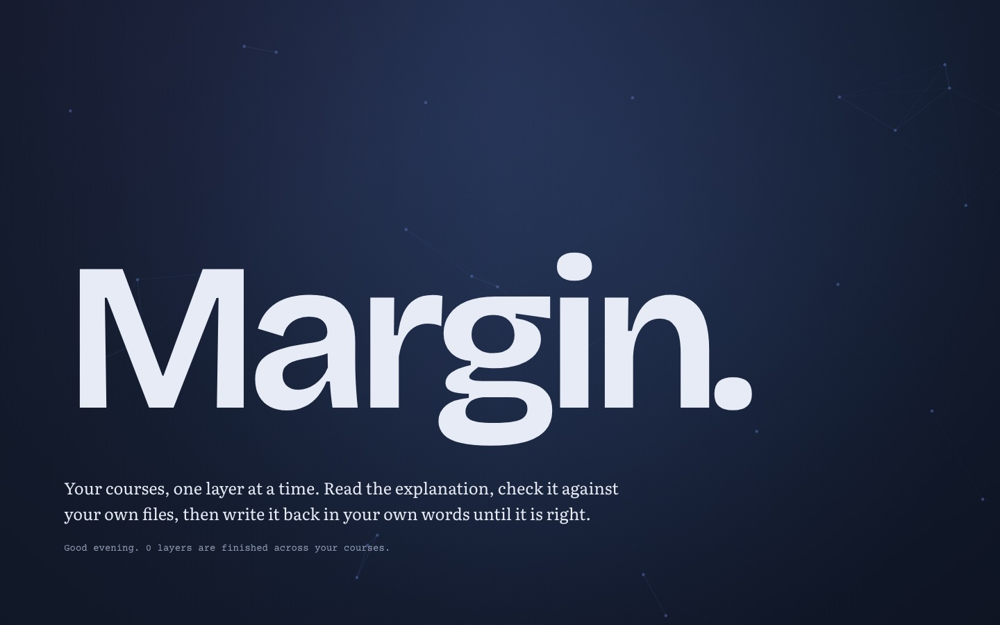

This is Margin at a glance: your courses, one layer at a time. You read the explanation, check it against your own files, and write it back in your own words until it is right.

### Your projects

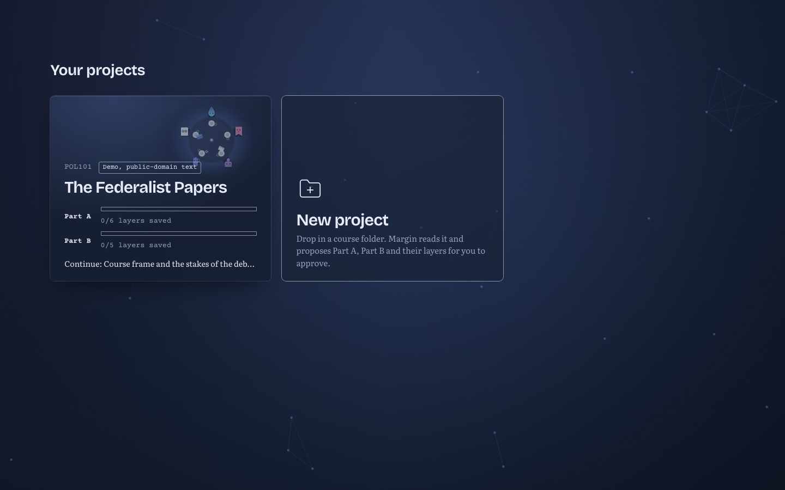

Each course is one card of the same size, with its progress for Part A and Part B and a link to continue where you left off. The New project card sits beside them.

### New project

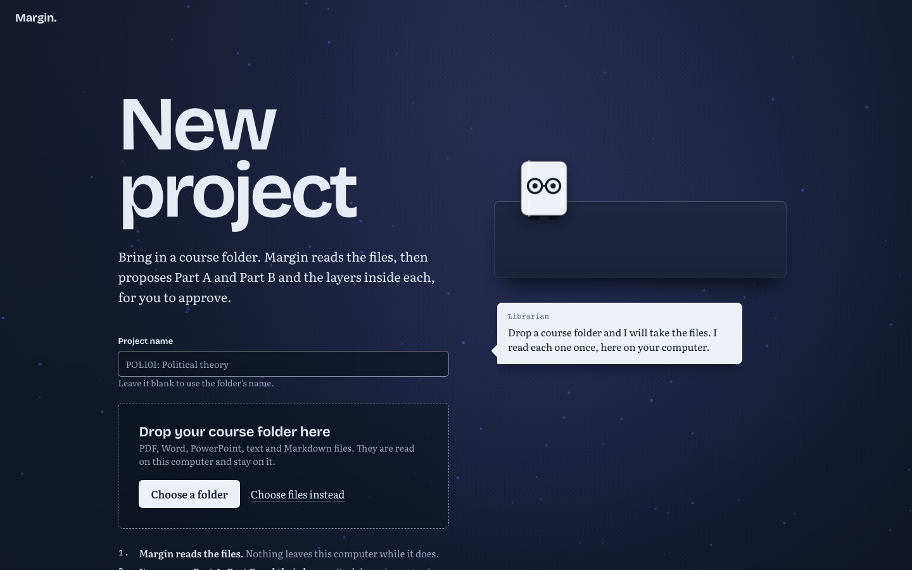

Drop in a course folder. The files are read on your computer and stay on it. Margin then proposes Part A, Part B and the layers inside each, and you approve or change them before anything is written.

### The project overview

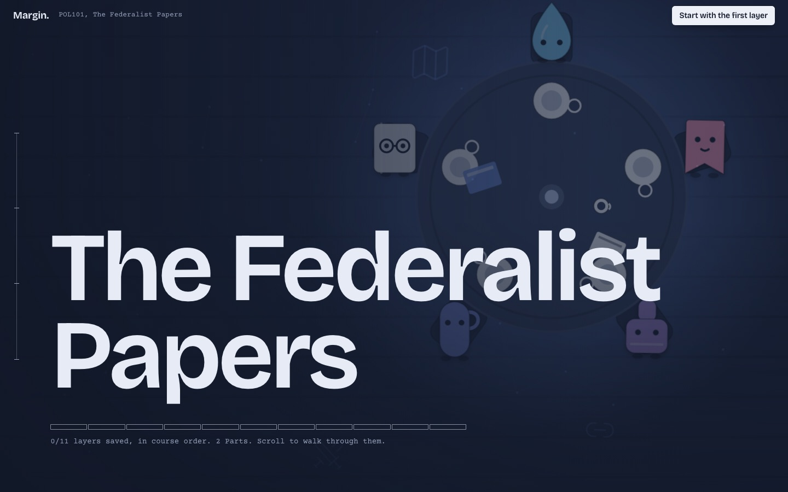

Opening a course starts with its title, its progress across all the layers, and a scroll-driven walk through the Parts, with one full-screen scene each. This is the expressive part of the app. The study workspace itself stays quiet.

### A Part

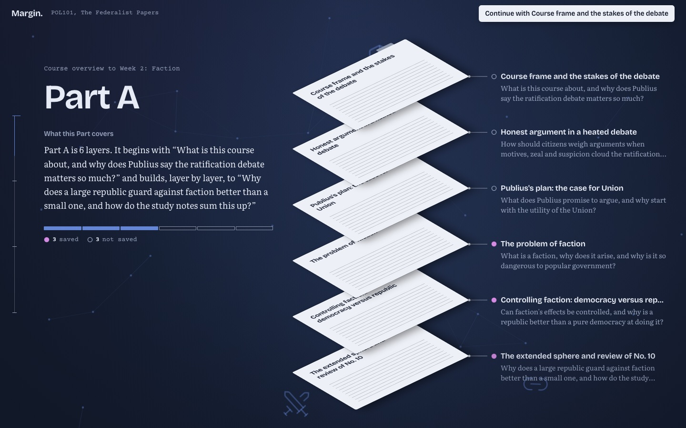

Each Part is split into topic layers that build on each other. Saved layers are marked in plum, and you scroll to walk through them.

### The agents

Five original characters each have a clear job. The **Explainer** writes each layer's explanation. The **Librarian** finds the passages, picks the source quotes and collects the sources from your conversations. The **Examiner** reviews your write-backs. The **Connector** writes the "so what" that links a layer to the bigger argument. The **Quizzer** explains again, more simply, when you are stuck.

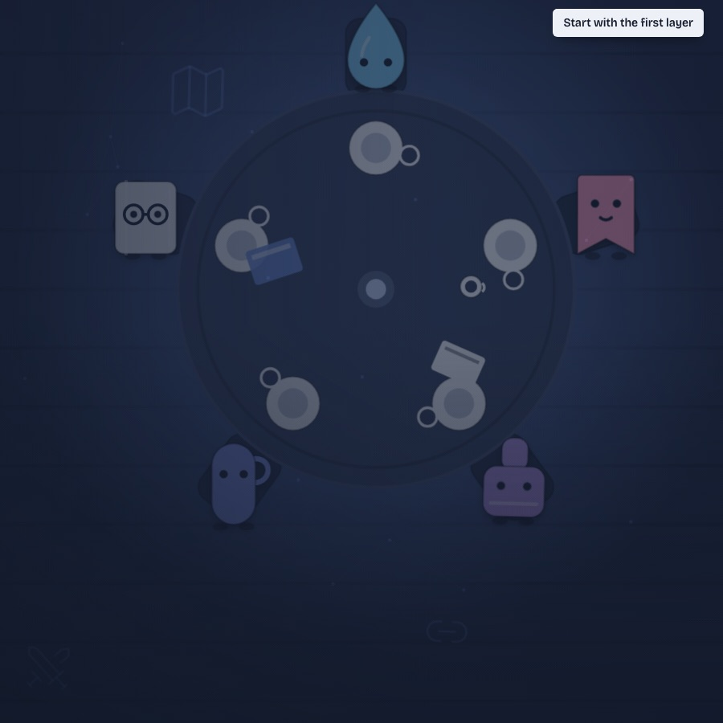

When nothing is running they share one table.

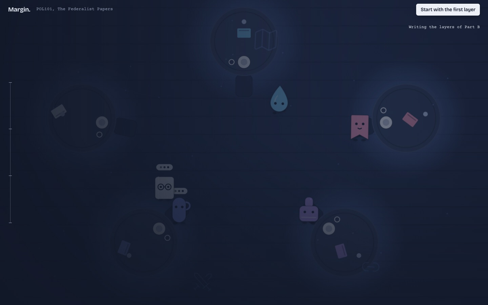

When they are working, the room widens to five tables, the agents move between them, and a line says what is happening, such as "Writing the layers of Part B". The room follows real background work for the Librarian's source collection today, and the other agents are being connected to it next.

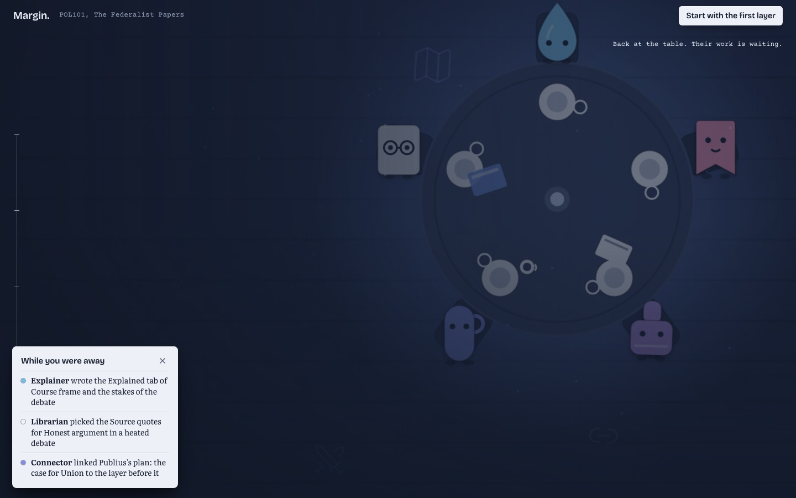

When they finish, a "While you were away" card sums up what each agent did.

## Who it is for, and the problem

It is for students who have the readings but no method for turning them into understanding. Most struggling students have the information, since it is all in the course folder. What they lack is a way to study it. Summaries and quizzes feel productive but are passive, and reading a good explanation is not the same as being able to write one.

Margin is built around one study method: **the AI explains one layer, you write it back in your own words, and the AI gives specific feedback until you get it right.** It is not a flashcard app, a summary app or a quiz app.

## How it works

1. **Bring material in.** Files are cut into sections that follow each file's own headings, slides or pages. This is plain code, not AI, and the original text is stored exactly as it appears in the file.
2. **Parts and layers.** Margin proposes a split into **Part A** (the first half of the course) and **Part B**, and then into **layers**: one topic each, with a title and the one big question it answers, ordered so each layer builds on the one before. You approve or change the breakdown before anything is written. Nothing is locked, so you can open any layer in any order.
3. **Explained and Source.** Each layer has two tabs. *Explained* is a plain-language explanation that starts from the basics, defines every name and term the first time it appears, and cites the page for every claim. *Source* is the exact original text it was based on, with file and page in the margin, so you can check the explanation against the real material.

   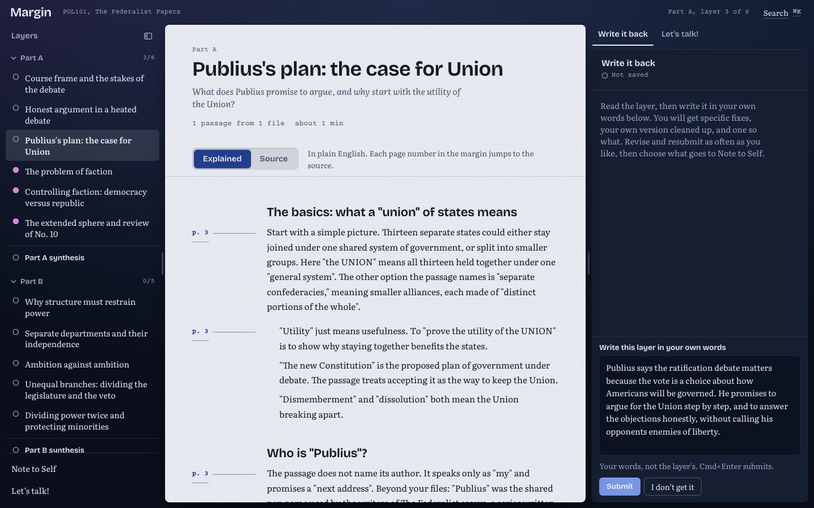

   *Explained*, with the write-back area on the right.

   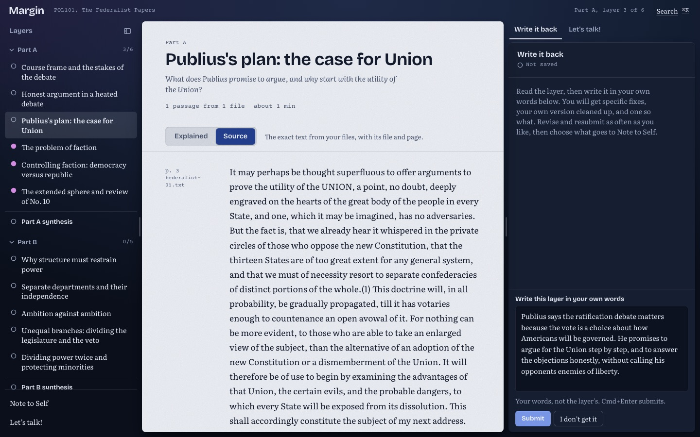

   *Source*: the original text, with file and page in the margin.

4. **Write it back.** You write the layer in your own words. The layer's tutor replies with specific fixes, a cleaned-up version of *your* writing (it keeps your wording where it can), and one "so what" sentence linking the layer to the bigger argument. You can revise and resubmit as often as you like. Then you choose what, if anything, to send to Note to Self.
5. **Note to Self.** A notebook that holds only what you chose to save, in course order, as two plain pages: your write-ups on the right and your quick notes on the left. It has its own chat that knows your notes, and you can highlight any passage to ask about it.

   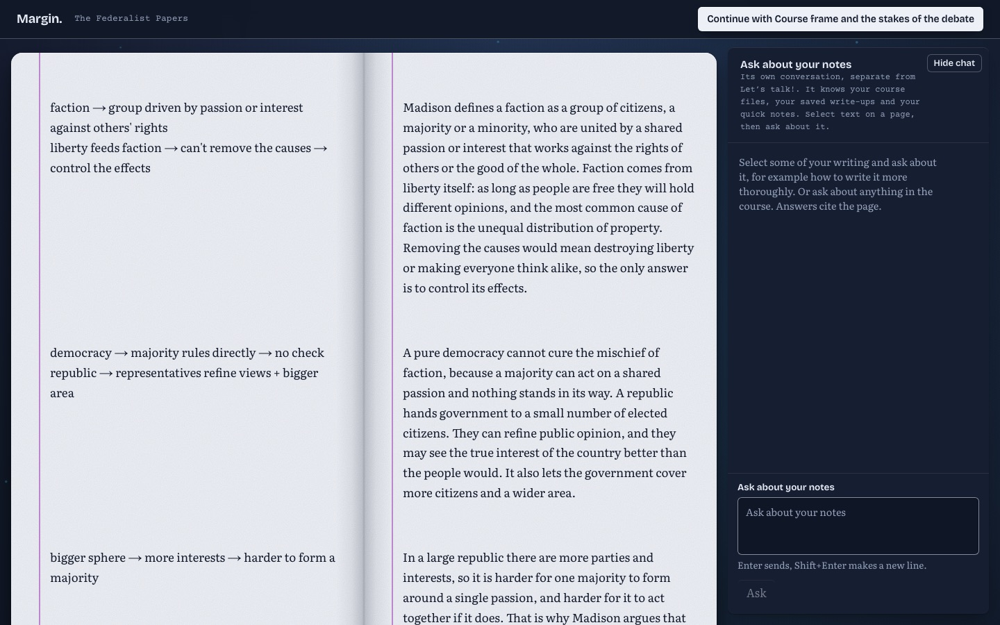

   *Note to Self*, the notebook.

   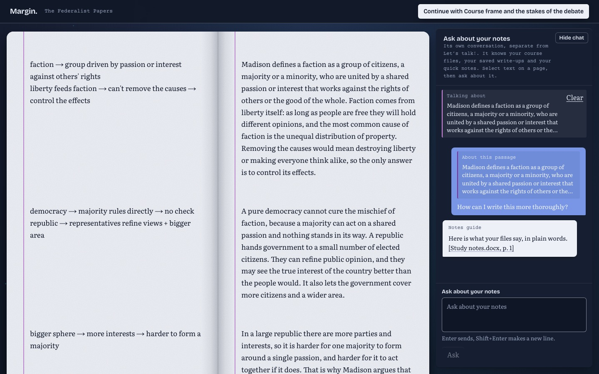

   Highlight any passage and ask about it. The chat knows your course files, your write-ups and your notes.

6. **Let's talk!** A project-wide conversation about the whole course, a Sources list that collects the verbatim passages the conversation relied on, and a full-page Notepad.

   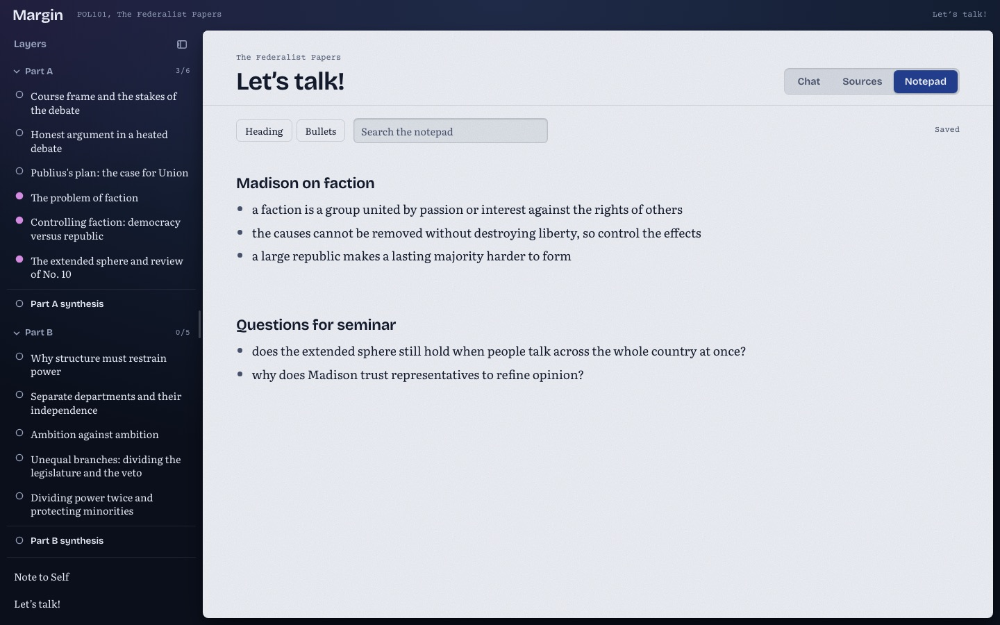

   The *Notepad* in Let's talk!.

## Why you can trust the answers

An AI study tool that sounds sure and is wrong teaches you the wrong thing. Margin is built so that cannot happen quietly.

- **The app finds the evidence, not the AI.** Margin searches your files itself and sends Claude only the top matching passages, each with its file and page. Claude has no other source.
- **Every claim must cite a page.** Explanations and feedback cite `[file, p. N]`. If a citation points to something that was not in the passages Claude was sent, it is removed before you see it.
- **Source quotes are copied by code, then checked.** The AI only chooses *which* passages to show. Code copies the text from storage and checks it word for word, and a quote that is not found verbatim is dropped, never shown.
- **The right model for the job.** Claude Opus writes the explanations and reviews your write-backs, because a mistake there would teach something wrong. Claude Sonnet handles lower-risk jobs: proposing the layer breakdown (which you approve), the course conversation and the notebook chat.

## Built with

- **Next.js** (App Router), **TypeScript** (strict) and **React**
- **Tailwind CSS v4** with design tokens, and **Motion** and **Lenis** for the scroll-driven overview
- **SQLite** with **FTS5** full-text search (BM25 ranking) through `better-sqlite3` and **Drizzle**
- **Zod** to validate every AI output and every API boundary
- **pdfjs**, **mammoth** and **jszip** to read PDF, Word and PowerPoint
- **Claude**, run through the official Claude Code command line on your own machine, behind one engine interface so another provider can be swapped in

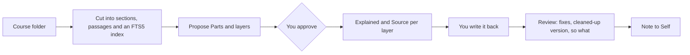

**Tests.** 394 unit tests (Vitest) and 52 browser tests (Playwright) cover importing, sectioning, the verbatim-text guarantees, layer-breakdown validation, citations, the review loop and the notebook. They all run offline against a fake AI engine, so they are fast and free to run.

## Status

Margin runs locally on a laptop. A beta with a few friends is the next step.

It was designed and directed by one student and built with Claude Code.

## Run it

You need Node.js 22 or newer. To use the real AI you also need the [Claude Code](https://claude.com/claude-code) command line installed and signed in.

```bash
npm install
npm run dev
```

Open <http://localhost:3000> and choose **Open the demo course**. To try the app without any AI at all, start it with `MARGIN_ENGINE=fake npm run dev`. The fake engine returns short, canned replies.

```bash
npm test             # unit tests
npm run test:e2e     # browser tests
```

## Licence

Copyright (c) 2026 0426HC (Margin). All rights reserved. The code is shared publicly for viewing as a portfolio project. See [LICENSE](LICENSE).
